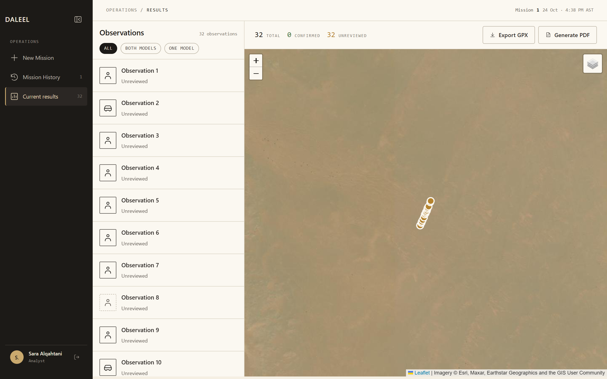
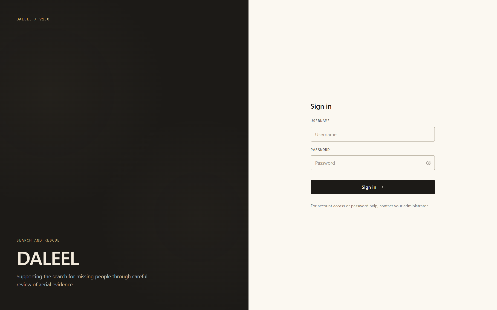
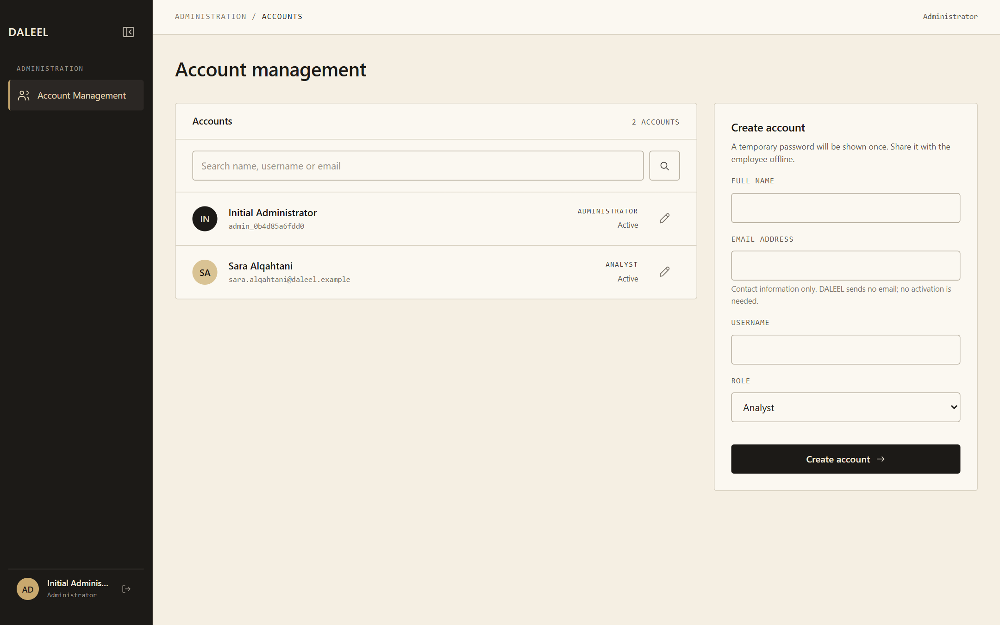
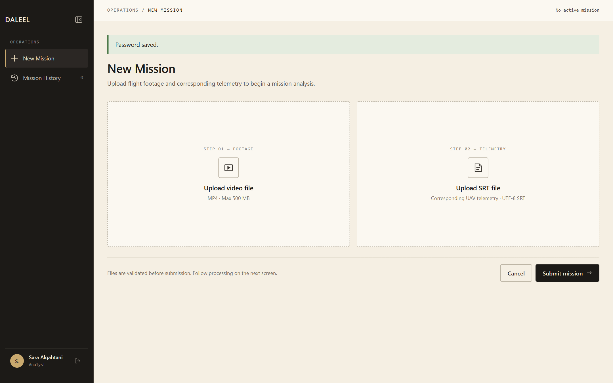
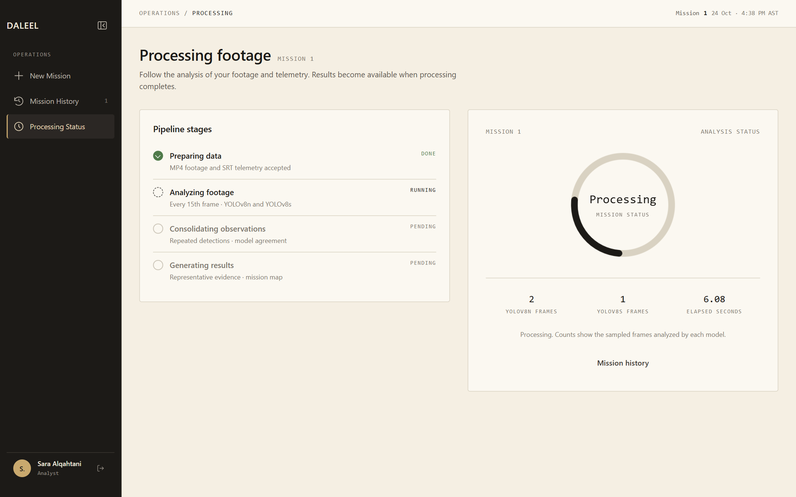
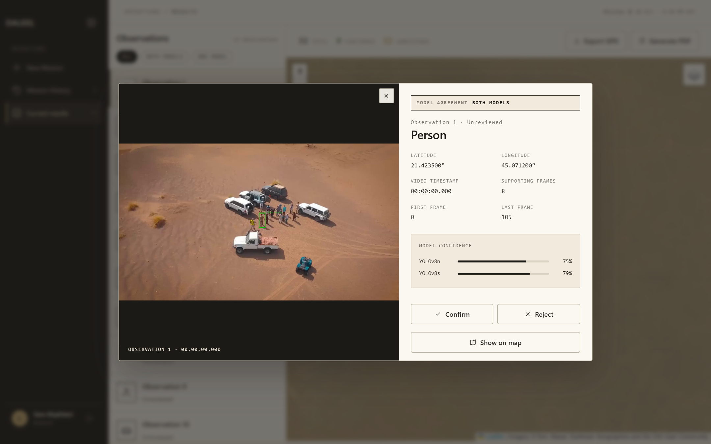
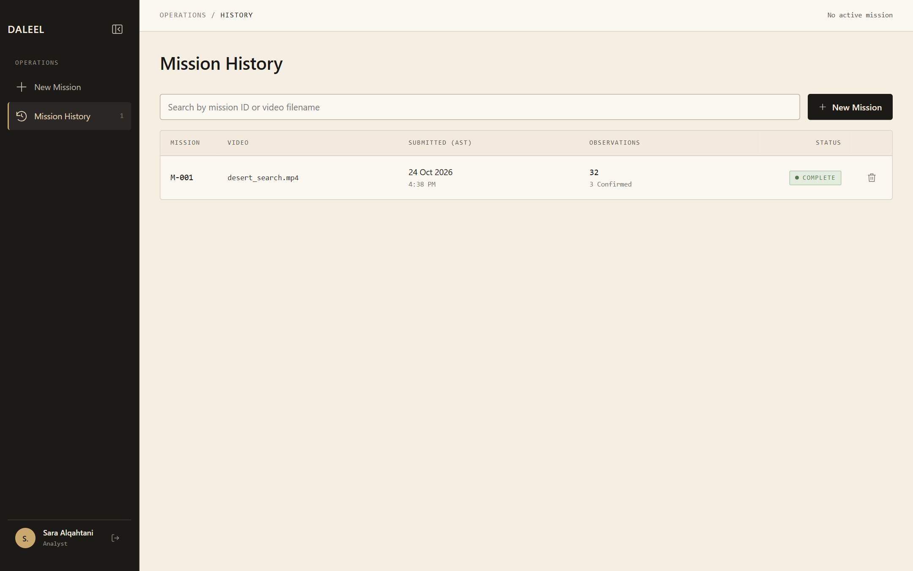

<h1 align="center">DALEEL</h1>

<p align="center">Turning drone footage into reviewable evidence for desert search and rescue teams</p>

<p align="center">
  
</p>

DALEEL is a web application developed as a university graduation project to support search
and rescue teams in desert environments. A team uploads the video recorded by a drone together
with its SRT flight log. Two detection models, YOLOv8n and YOLOv8s, examine the footage for
people and vehicles. DALEEL shows every finding with its image, time, location and the models
that reported it, and lets the team confirm or reject each one before exporting a PDF report
and GPX map points.

## Preview

<details>
<summary>Show screens</summary>

| Sign in | Account management | New mission |
| --- | --- | --- |
|  |  |  |

| Processing | Observation evidence | Mission history |
| --- | --- | --- |
|  |  |  |

</details>

## Try DALEEL

These steps take you from installation to an exported report, using the demonstration flight
included in the repository (its coordinates are illustrative). They are written for 64-bit
Windows; see [Supported systems](#supported-systems) for what has been tested.

**What the first start needs:** an internet connection, about 610 MB of downloads and about
3 GB of free disk space. You do not need to install Python or anything else first.

| Download | Size | Source |
| --- | ---: | --- |
| DALEEL release v2.0.2 | 30 MB | this repository |
| Python 3.10.11 | 16 MB | python.org's official NuGet package, checked by its SHA-256 and signature |
| Python packages (PyTorch, Ultralytics, OpenCV and others) | 540 MB | PyPI, at the exact versions in [`requirements-lock.txt`](requirements-lock.txt) |
| The two detection models | 29 MB | this repository's [release v2.0.0](https://github.com/SarahAlyahya001/DALEEL/releases/tag/v2.0.0), checked by their SHA-256 |

Everything is stored inside the DALEEL folder. A Python already on the computer is not used or
changed, and deleting the folder removes DALEEL completely.

<details open>
<summary><b>1. Install and start DALEEL</b></summary>

**Recommended: one command.** Press **Windows key + R**, paste this line and press **Enter**:

```text
powershell -ExecutionPolicy Bypass -c "irm https://raw.githubusercontent.com/SarahAlyahya001/DALEEL/v2.0.2/scripts/install.ps1 | iex"
```

A window opens and downloads DALEEL v2.0.2 into the folder `DALEEL` in your user folder (for
example `C:\Users\<name>\DALEEL`). It then sets DALEEL up in three numbered steps, showing the
progress of each download, and starts it. How long this takes depends mainly on the speed of the
internet connection. If the connection drops, run the command again: completed downloads are
kept.

**Alternative: ZIP file.**

1. Download **Source code (zip)** from the
   [v2.0.2 release](https://github.com/SarahAlyahya001/DALEEL/releases/tag/v2.0.2).
2. Right-click the ZIP file, choose **Extract All…** and then **Extract**.
3. Open the extracted folder, the one that contains `start.bat`. Right-click an empty area of
   the folder, choose **Open in Terminal**, type `.\start.bat` and press **Enter**.

`start.bat` can also be double-clicked, but depending on its security settings, Windows may not
open a file from a downloaded ZIP file this way. The terminal works in either case.

</details>

<details>
<summary><b>2. Sign in as the Administrator</b></summary>

When the setup has finished, the same window starts DALEEL. The first time only, it shows a
**temporary Administrator username and password**. They are shown once and stay in the window
until you close it.

1. Copy them: select them with the mouse and right-click. (Pressing **Ctrl+C** without a
   selection stops DALEEL.)
2. Open **http://127.0.0.1:5000** in your browser and sign in with them.
3. Choose a personal password of at least 15 characters, enter it twice and choose
   **Save password**. The **Account management** page opens.

Keep the DALEEL window open while you use DALEEL. If it was closed before you signed in, see
[Forgotten Administrator password](docs/ACCOUNT_MANAGEMENT.md#forgotten-administrator-password).

</details>

<details>
<summary><b>3. Create an analyst account</b></summary>

The Administrator manages accounts; missions are uploaded and reviewed by analysts.

1. Under **Create account**, enter a full name, an email address and a username, and leave the
   role as **Analyst**. The email address is contact information only; DALEEL sends no email.
2. Choose **Create account**. The analyst's username and temporary password are shown once;
   choose **Copy username and password** and keep them for the next step.
3. Choose **Sign out** at the bottom of the left sidebar.

</details>

<details>
<summary><b>4. Sign in as the analyst</b></summary>

1. On the sign-in page, sign in with the analyst's username and temporary password.
2. Choose a personal password for the analyst and choose **Save password**. The **New Mission**
   page opens.

From then on, the analyst signs in at **http://127.0.0.1:5000** with this username and personal
password.

</details>

<details>
<summary><b>5. Upload the demonstration flight</b></summary>

The demonstration files are in the `demo` folder inside the DALEEL folder (for example
`C:\Users\<name>\DALEEL\demo`): the video `desert_search.mp4` and its flight log
`desert_search.srt`.

1. Under **Upload video file**, select `desert_search.mp4`.
2. Under **Upload SRT file**, select `desert_search.srt`.
3. Choose **Submit mission**.

The status page follows the analysis as it runs. How long it takes depends on the computer and
on what else it is doing at the time: on the test laptop (Intel Core i7-1355U, 16 GB RAM), the
demonstration flight took between one and four minutes. When the status shows **Complete**,
choose **View results**.

</details>

<details>
<summary><b>6. Review the observations</b></summary>

1. The list on the left shows every observation; the map shows where the drone was when each
   one was seen, which approximates but is not the exact position of the target. Each
   observation is labeled **Both models** when YOLOv8n and YOLOv8s both reported it, or
   **One model** when only one of them did, with each model's confidence (a dash means that
   model did not report it). The filter buttons show one group. The label is information about
   the models; the decision is yours.
2. Select an observation to see its evidence image, its time in the video and its coordinates.
   **Show on map** locates it on the map.
3. Choose **Confirm** or **Reject** for the observations you have reviewed.

</details>

<details>
<summary><b>7. Export the results</b></summary>

- **Generate PDF** downloads a report of every observation in the mission and its review
  decision, including observations not yet reviewed.
- **Export GPX** downloads map points that can be opened in mapping and navigation tools. It
  contains only **confirmed** observations that have coordinates, so confirm at least one such
  observation first; otherwise the file contains no points.

</details>

<details>
<summary><b>8. Return to earlier missions</b></summary>

**Mission History** in the left sidebar lists the analyst's missions. Open one to see its
results again, or delete a completed mission after confirming.

</details>

<details>
<summary><b>9. Stop DALEEL and start it again later</b></summary>

- **Stop:** close the DALEEL window.
- **Start again:** run `start.bat` in the DALEEL folder (for example by opening a terminal there
  and typing `.\start.bat`), or run the one-line command from step 1 again. Later starts skip the
  setup and open DALEEL in your browser; sign in with your personal password. DALEEL can also be
  started directly with `.\.venv\Scripts\python.exe run.py` in a terminal in the DALEEL folder.

Accounts, passwords, missions and evidence are kept in the `instance` folder inside the DALEEL
folder. Starting DALEEL again, or running the setup again, does not change them.

</details>

To analyze your own flights, upload the MP4 video (up to 500 MB) together with the SRT file
recorded during the same flight. Many DJI drones can save this file next to each video when
video subtitles are enabled in the camera settings.

## Troubleshooting

| Situation | What to do |
| --- | --- |
| Windows does not open `start.bat` when it is double-clicked | Open a terminal in the DALEEL folder and run `.\start.bat`. |
| The first start stopped, for example because the connection dropped | Run the command or `start.bat` again. Completed downloads are kept, and the window names the step that failed. |
| "Another program is using port 5000" | Close that program, or run `$env:DALEEL_PORT = '5050'; .\start.bat` in PowerShell in the DALEEL folder and open http://127.0.0.1:5050. |
| The temporary Administrator password was lost | Follow [Forgotten Administrator password](docs/ACCOUNT_MANAGEMENT.md#forgotten-administrator-password). |
| The command reports that the DALEEL folder already contains an earlier version | It does not change that installation. To update while keeping accounts and missions, follow [Updating to a new release](docs/ACCOUNT_MANAGEMENT.md#updating-to-a-new-release). |
| The folder `DALEEL` already exists for something else | Rename or move that folder, then run the command again. |

## Supported systems

| System | Status |
| --- | --- |
| Windows 11, 64-bit | Tested: installation with the one-line command, the complete workflow above, and restarting with existing data. |
| Windows 10, 64-bit | Expected to work in the same way; not tested. |
| Linux (x86-64) | Checked automatically on Ubuntu 26.04 (GitHub Actions): `sh start.sh` sets DALEEL up, both models load, and the website starts and serves its sign-in page. The workflow in the browser has not been tested on Linux. |
| macOS on Apple silicon, Linux on ARM64 | `sh start.sh` is provided; not tested. |
| Server with Docker | See [Put DALEEL online](#put-daleel-online). |

On Linux and macOS, run `sh start.sh` in the extracted folder instead of `start.bat`; it uses
Python 3.10.11 from python-build-standalone. On Ubuntu or Debian, OpenCV may first need
`sudo apt install libgl1 libglib2.0-0`. To install without a start script on any system, see
[Install without the start script](docs/LOCAL_SETUP.md#install-without-the-start-script).

## Put DALEEL online

DALEEL is designed to run on a server under your own domain, served over HTTPS, so that teams
can use it from any browser. [docs/DEPLOYMENT.md](docs/DEPLOYMENT.md) walks through it in six
steps with Docker.

## More information

| Topic | Document |
| --- | --- |
| Accounts, password recovery, data location and updating to a new release | [docs/ACCOUNT_MANAGEMENT.md](docs/ACCOUNT_MANAGEMENT.md) |
| Model files, settings, offline use and installing without the start script | [docs/LOCAL_SETUP.md](docs/LOCAL_SETUP.md) |
| Training data, evaluation and results of the detection models | [docs/DATASET_EVALUATION.md](docs/DATASET_EVALUATION.md) |

To run the automated tests, install the test tools and run pytest:

```powershell
.\.venv\Scripts\python.exe -m pip install -r requirements-dev.txt
.\.venv\Scripts\python.exe -m pytest -q
```

To run only the requirement-based unit and integration tests described in Chapter 6 of the
project report:

```powershell
.\.venv\Scripts\python.exe -m pytest tests/test_requirements.py -v
```

To check the rendered interface in Microsoft Edge (layout at five screen widths, keyboard use,
accessibility, reduced motion and the results page), with Node.js installed:

```powershell
node tests/inspect_interface.mjs
```

To measure the processing time and memory for a 60-second 1080p video (NFR-01 and NFR-02):

```powershell
.\.venv\Scripts\python.exe scripts/measure_runtime.py
```

## Credits

- Object detection: [Ultralytics YOLOv8](https://github.com/ultralytics/ultralytics) (AGPL-3.0).
- Maps: [Leaflet](https://leafletjs.com/) (BSD 2-Clause), with imagery from Esri World Imagery
  and OpenStreetMap.
- Training and evaluation data: the [HERIDAL](https://zenodo.org/records/5662351)
  search-and-rescue dataset and the [VisDrone](https://github.com/VisDrone/VisDrone-Dataset)
  dataset, used to fine-tune and evaluate the two models; neither dataset is included in this
  repository. The splits are described in [docs/DATASET_EVALUATION.md](docs/DATASET_EVALUATION.md).
